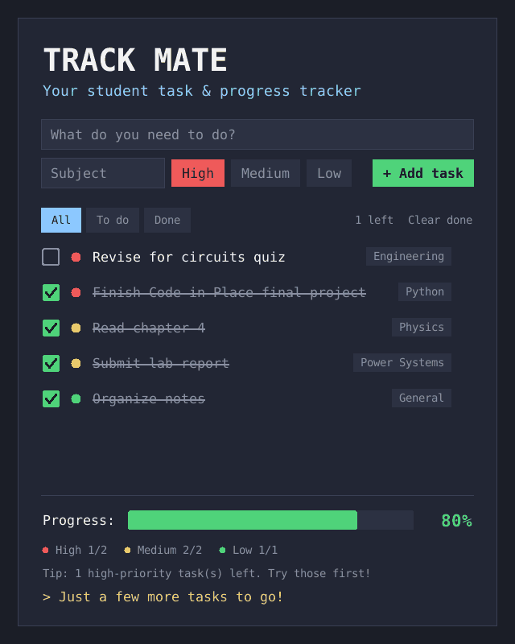

# Track Mate 📋

A student task and progress tracker, made as my final project for Stanford's **Code in Place**.

<p align="center">
  
</p>

## What it does

- Add study tasks with a subject and a priority (High 🔴, Medium 🟡, Low 🟢)
- Tick tasks off (or untick them) with one click
- Filter the list by **All**, **To do** or **Done**
- Delete a task, or clear all finished ones at once
- Watch a progress bar fill up, with a breakdown by priority
- Get a reminder about high-priority tasks and a short encouraging message
- Tasks are saved automatically, so they're still there next time

## How to run it

You need Python 3.8 or newer. Nothing else to install, because the window uses `tkinter`, which comes with Python.

```bash
python3 track_mate_app.py
```

The first time, it starts with a few sample tasks so you can try it out. Your tasks are saved in `tasks.json` next to the program.

> **Linux note:** if you get `No module named 'tkinter'`, install it with `sudo apt install python3-tk`.

### Terminal version

The original menu-based version is still here too:

```bash
python3 track_mate.py
```

```
📊 PROGRESS REPORT
Overall progress: ████████░░░░░░░░░░░░ 40%
Completed tasks: 2 out of 5

Progress by priority:
🔴 High: 0/2 completed
🟡 Medium: 2/2 completed
🟢 Low: 0/1 completed

Tip: You still have 2 high-priority task(s). Try those first!
```

## Files

| File | What it is |
| --- | --- |
| `track_mate_app.py` | The window version (main app) |
| `track_mate.py` | The terminal version |
| `assets/` | Screenshot for this README |

## Ideas for later

- Add due dates and sort by deadline
- Edit a task's name or priority after adding it
- A dark/light theme switch
